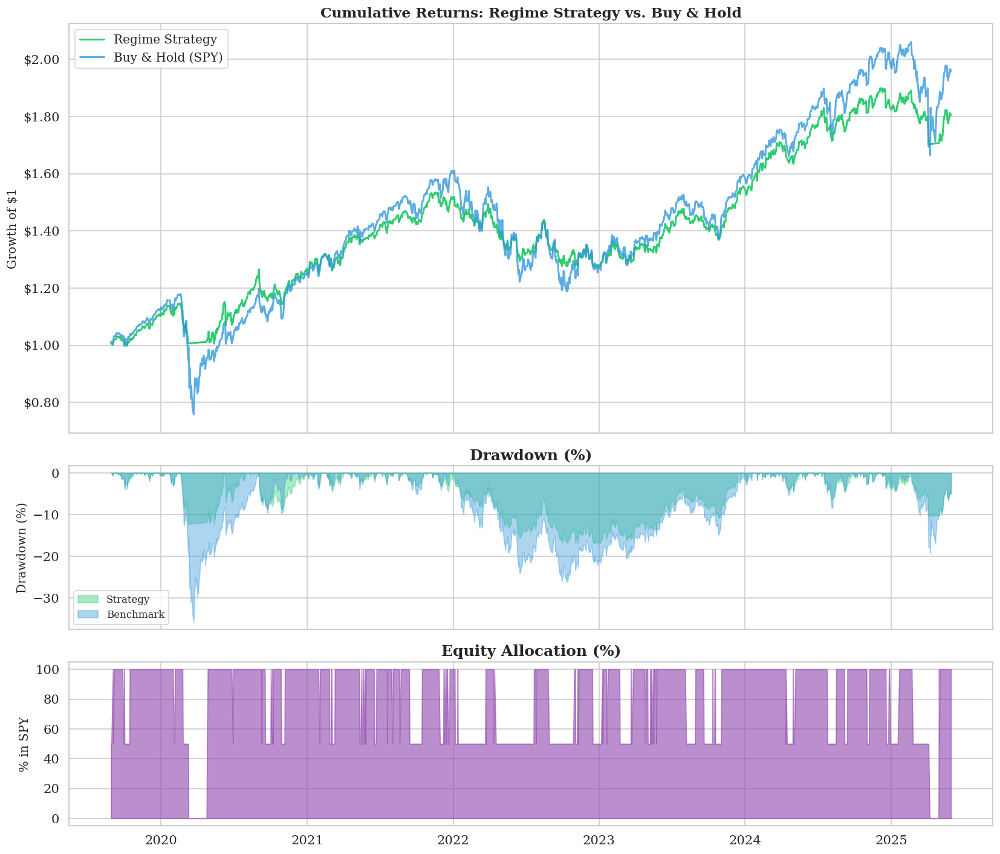
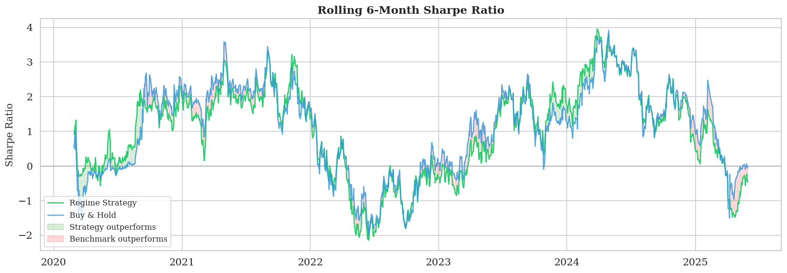
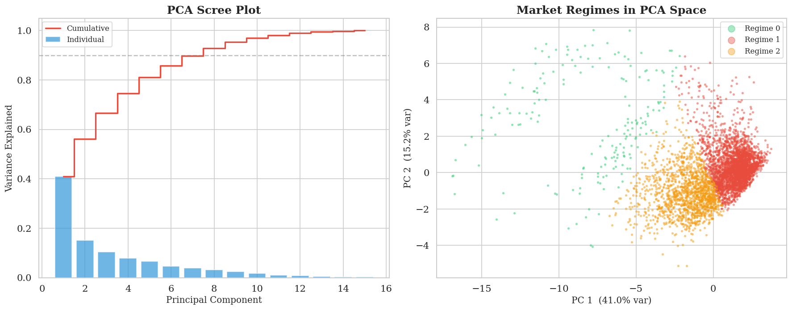
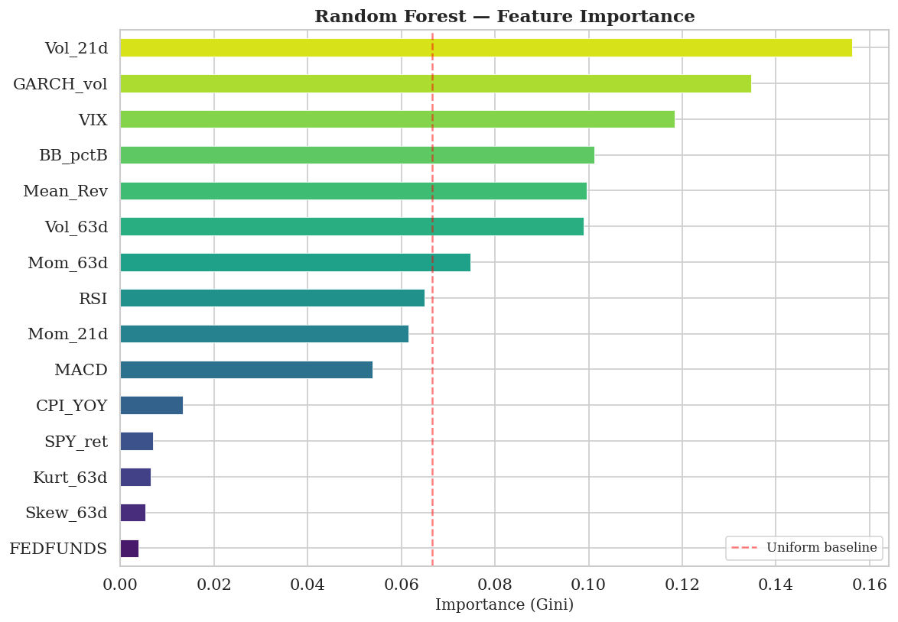
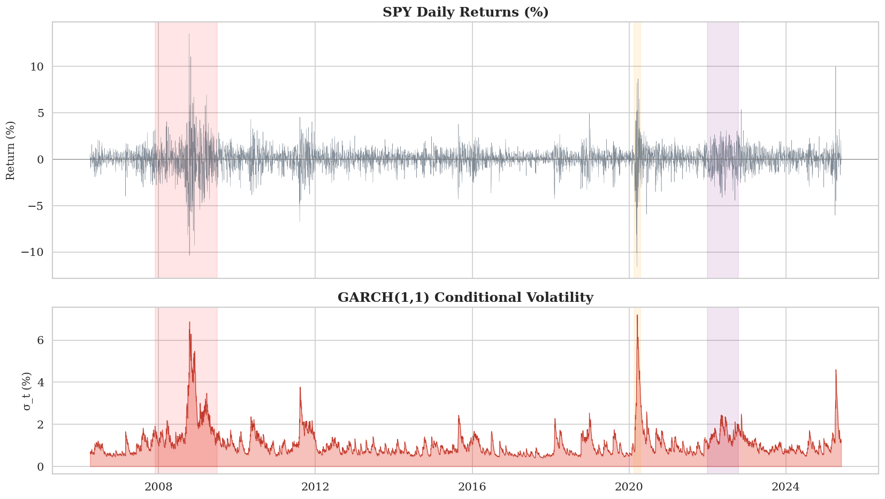

# 📈 Predicting Market Regimes with GARCH, Clustering, and Machine Learning

[](https://www.python.org/)
[](https://jupyter.org/)
[](https://scikit-learn.org/)

**Can a model detect risk-off market regimes early enough to cut drawdowns without giving up too much return?**
This project builds an end-to-end quantitative pipeline on 20+ years of daily SPY, VIX, and macro data. It uses GARCH volatility features, unsupervised clustering to discover market regimes, and supervised classifiers to forecast the next regime. A walk-forward backtest then shifts allocation between equities and cash based on the forecast.

**Result in one line:** in the 2019–2025 out-of-sample test, the regime strategy cut volatility by about 40% and halved the maximum drawdown versus buy-and-hold SPY, while improving Sharpe, Sortino, and Calmar ratios.

📓 **[Main notebook](market_regime_asset_pricing.ipynb)** · 📓 **[Volatility forecasting notebook](spx_volatility_forecasting.ipynb)**

*By Sai Kadiyala*

---

## Results (Walk-Forward Out-of-Sample, 2019–2025)

| Metric | Regime strategy | Buy & hold (SPY) | Change |
|---|:---:|:---:|:---:|
| Annualized volatility | **12.70%** | 21.08% | −39.8% |
| Maximum drawdown | **−17.21%** | −35.75% | about half |
| Sharpe ratio | **0.561** | 0.473 | +18.6% |
| Sortino ratio | **0.700** | 0.565 | +23.9% |
| Calmar ratio | **0.624** | 0.341 | +83.0% |
| Win rate (daily) | **56.8%** | 55.3% | +1.5 pp |

The strategy did its job in the two worst stretches of the test period, the March 2020 COVID crash and the 2022 rate-hiking bear market, by cutting equity exposure as the forecast regime turned risk-off.

<p align="center">
  
</p>

<p align="center">
  
</p>

---

## Pipeline

```text
Market data: SPY, VIX, macro yields (2005 → present)
        │
        ▼
1. Feature engineering ── GARCH(1,1) with Student-t errors (conditional volatility),
        │                 rolling momentum, realized variance, volume spread
        ▼
2. Regime discovery ───── PCA + K-Means (unsupervised, no hand-labeled regimes)
        │                 Risk-On 64.4% · Transition 31.7% · Risk-Off 3.9% of days
        ▼
3. Regime forecasting ─── Random Forest and Gradient Boosting on lagged features,
        │                 expanding-window training (89.2% accuracy)
        ▼
4. Allocation backtest ── Risk-On: 100% SPY · Transition: 50% SPY / 50% cash
                          Risk-Off: 100% cash
```

| Stage | Why it's there |
|---|---|
| GARCH(1,1), Student-t | Captures volatility clustering and fat tails in returns |
| PCA + K-Means | Lets the data define regimes instead of imposing labels |
| Lagged features, expanding window | Each prediction uses only information available at that date |
| Rule-based allocation | Keeps the strategy simple and easy to interpret |

---

## What Drives the Regimes

<p align="center">
  
  
</p>

*Left: in PCA space, calm risk-on days separate cleanly from high-volatility risk-off days. Right: GARCH conditional volatility and the VIX term structure are the strongest predictors of the next regime.*

<p align="center">
  
</p>

---

## Limitations

- **One out-of-sample path.** The test window covers a single historical sequence, including two large sell-offs. It shows the approach worked on this data, not that it will work in the future.
- **Rare crisis class.** Only 3.9% of days are labeled Risk-Off, so overall classification accuracy (89.2%) is dominated by the common regimes. Per-regime precision and recall matter more than the headline number.
- **Regimes are model-defined.** K-Means clusters are not "true" market states, and labels can shift if features or cluster counts change.
- **Simple execution assumptions.** Results are gross of transaction costs, taxes, and slippage, and cash earns the risk-free rate.
- **Past performance does not predict future returns.** This is a research project, not investment advice.

---

## Repository Structure

```text
predicting-market-regimes/
├── README.md
├── requirements.txt
├── .gitignore
├── market_regime_asset_pricing.ipynb    # Full pipeline and backtest
├── spx_volatility_forecasting.ipynb     # Supplemental GARCH and HAR volatility models
└── figures/
    ├── backtest_performance.png
    ├── rolling_sharpe.png
    ├── pca_regime_clusters.png
    ├── feature_importance.png
    └── garch_conditional_volatility.png
```

---

## Run It Yourself

```bash
git clone https://github.com/psailus/predicting-market-regimes.git
cd predicting-market-regimes
pip install -r requirements.txt
jupyter notebook market_regime_asset_pricing.ipynb
```

Requires Python 3.10+.

---

## Tools

Python · pandas · NumPy · `arch` (GARCH) · scikit-learn (PCA, K-Means, Random Forest, Gradient Boosting) · Matplotlib · Jupyter
